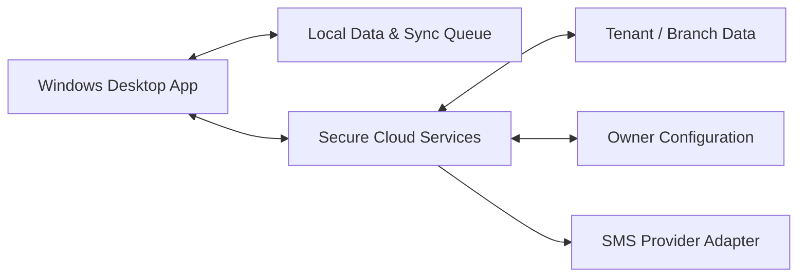

# RepairPRO

### Repair Shop Management. Connected Across Branches.

**A commercial Windows desktop platform concept for modern device repair businesses.**

[Product Overview](docs/PRODUCT_OVERVIEW.md) · [Architecture](docs/SYSTEM_ARCHITECTURE.md) · [Roadmap](docs/COMMERCIAL_RELEASE_ROADMAP.md)

**Developed by [Kavindu Rasanja](https://kavindurasanja.vercel.app/)**

---

## About RepairPRO

RepairPRO is a commercial software project focused on helping mobile-device repair shops organize daily repair operations, inventory, payments and branch-level business activity through a Windows desktop application with a cloud-connected architecture.

This public repository is the **official product showcase and documentation hub**. It is intended for customers, business partners and developers who want to understand the product direction and its documented architecture.

> **This is not the application source-code repository.** The proprietary application source, private backend implementation, production configuration and credentials are not published here.

## Product capabilities

The product scope is organized around these workflows. Individual capabilities may still be under development; consult release notes or contact the developer to confirm availability in a particular build.

| Area | Product direction |
|---|---|
| Repair management | Customer and device registration, repair tickets, diagnosis, estimates and status tracking |
| Technician workflow | Job assignment and repair progress |
| Inventory | Parts catalogue, stock movements, purchases and barcode labels |
| POS & payments | Sales, payments, receipts and operational reporting |
| Multi-branch cloud | Owner view and authorized branch coordination |
| Offline-aware desktop | Local workflow continuity and later synchronization |
| Notifications | Server-side SMS gateway integration |
| Printing | Repair documents, invoices, job sheets and labels |

## Architecture at a glance

This is a high-level product architecture illustration. It is not a deployment diagram and does not disclose production infrastructure or credentials.

## Documentation

- [Product Overview](docs/PRODUCT_OVERVIEW.md)
- [System Architecture](docs/SYSTEM_ARCHITECTURE.md)
- [Cloud Architecture](docs/CLOUD_ARCHITECTURE.md)
- [Multi-Branch System](docs/MULTI_BRANCH_SYSTEM.md)
- [Logical Data Model](docs/DATABASE_SCHEMA.md)
- [Security Principles](docs/SECURITY.md)
- [Data Protection](docs/DATA_PROTECTION.md)
- [SMS Integration Overview](docs/SMS_GATEWAY.md)
- [Commercial Release Roadmap](docs/COMMERCIAL_RELEASE_ROADMAP.md)
- [Deployment Guide](docs/DEPLOYMENT_GUIDE.md)
- [Testing Guide](docs/TESTING_GUIDE.md)

Some architecture and workflow documents describe the intended design. They must not be interpreted as proof that every feature or control is already implemented.

## Screenshots & product demos

Product screenshots and demo videos will be added here after they have been reviewed and cleared for public release.

- `assets/screenshots/` — approved, sanitized screenshots
- `assets/demo/` — public demo media

Do not add real customer names, phone numbers, IMEI/serial numbers, invoices, credentials or production records to public media.

## Platform & commercial direction

- **Client platform:** Windows Desktop
- **Market focus:** Sri Lanka
- **Commercial model:** Lifetime purchase direction; final licence terms are subject to the commercial agreement.
- **Cloud model:** Multi-branch cloud-connected architecture
- **Product owner / developer:** Kavindu Rasanja

## Security & intellectual property

RepairPRO is proprietary commercial software. All rights are reserved by the copyright holder. This public repository contains product information and documentation only.

- No application source code is licensed for reuse by this repository.
- No permission is granted to copy, modify, redistribute, sublicense or commercially exploit the proprietary product.
- Do not submit security vulnerabilities in public issues. See [Security Policy](SECURITY.md).
- Never commit secrets, customer data, production exports or private configuration.

See [LICENSE](LICENSE) for the repository notice.

## Contact

**Kavindu Rasanja**  
Portfolio: https://kavindurasanja.vercel.app/

For product enquiries, demonstrations, licensing and business partnerships, contact the developer through the portfolio or LinkedIn profile.

---

**RepairPRO — Built for repair businesses. Designed for connected operations.**

© 2026 Kavindu Rasanja. All rights reserved.

