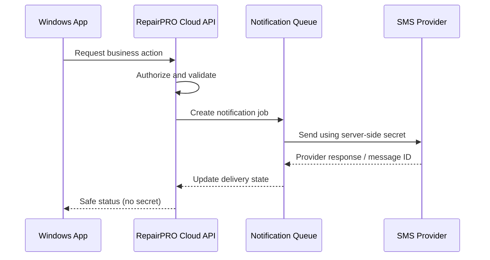

# SMS Gateway Integration

## Objective

Provide repair-related customer notifications through a server-side provider adapter. The current product direction includes Notify.lk as a potential provider; confirm account/API capabilities, pricing, sender-ID approval and terms before production use.

## Suggested events

- Repair ticket received.
- Estimate approval requested.
- Repair status changed.
- Repair completed / ready for collection.
- Optional technician or internal operational alert.

Only send messages enabled by the business and permitted by the customer's communication preferences and applicable law.

## Security architecture

The desktop client must never hold the SMS provider password or API token.

## Operational requirements

- Store credentials in a managed secret store or protected server environment.
- Keep provider adapter separate from business workflow code.
- Use an idempotency key to prevent duplicate messages on retries.
- Apply per-tenant quotas, rate limits and spending controls.
- Record template version, destination, provider reference and status.
- Avoid logging full message bodies or secrets unnecessarily.
- Handle queued, submitted, delivered, failed and unknown states distinctly.
- Provide a test mode that cannot accidentally message real customers.

## Configuration

Owner-managed settings should update centrally. Branch clients should not receive raw provider credentials. Record who changed a setting, when, and which version became active.

## Production checklist

- [ ] Provider account and sender ID approved.
- [ ] Pricing and message limits confirmed.
- [ ] Consent and opt-out workflow reviewed.
- [ ] Secret storage and rotation tested.
- [ ] Duplicate-send tests passed.
- [ ] Delivery callback authenticity verified.
- [ ] Quotas, alerts and failure handling configured.
