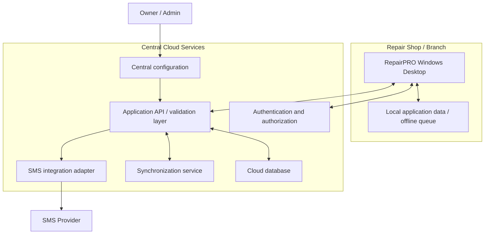

# System Architecture

## 1. Target logical architecture

This is a logical target diagram, not a verified deployment diagram. Confirm the actual service boundaries and technology choices before implementation.

## 2. Client

Current platform decision: Windows desktop application.

The existing product direction uses a web UI packaged for Windows with Electron. Confirm the final build tooling, Electron version, renderer process, preload boundary and IPC surface from the source repository before documenting them as facts.

Client responsibilities:
- Render role-appropriate workflows.
- Validate inputs for usability (server must validate again).
- Persist permitted offline work safely.
- Queue synchronization operations.
- Show sync state, errors and retry outcomes.
- Never embed privileged cloud credentials.

## 3. Cloud services

Expected responsibilities:
- Authenticate users and resolve tenant / branch context.
- Enforce role, tenant and branch authorization on every operation.
- Validate business rules and transaction invariants.
- Store authoritative cloud records.
- Coordinate synchronization and conflict handling.
- Manage centrally controlled settings.
- Dispatch notifications through provider adapters.
- Record auditable security-sensitive actions.

## 4. Data ownership

Every business record must be scoped to a tenant. Branch-owned records should also include a branch identifier. The backend must derive or verify tenant and branch scope from the authenticated identity; it must not trust a client-supplied `tenantId` or `branchId` alone.

## 5. Architecture constraints

- No direct client access to privileged service credentials.
- No security decisions based only on hidden UI elements.
- No unbounded retry loops for cloud writes or SMS sends.
- No silent last-write-wins for high-value records such as payments, stock movements or repair status transitions.
- All schema changes require migration notes and a rollback strategy.
- Cloud and local data models must have explicit versioning.
